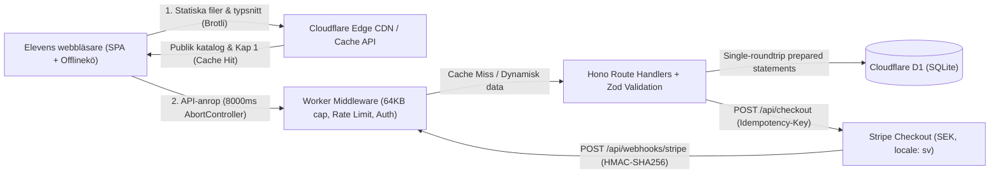

# Master Architecture & Implementation Plan (`PLAN.md`)

**Platform:** Swedish Upper Secondary School (*Gymnasiet / Gy25*) Study Platform  
**Stack:** Cloudflare Workers with Static Assets (Cloudflare Pages-compatible) + Hono (TypeScript) + Cloudflare D1 (SQLite) + Stripe Checkout  
**Workspace Root:** `C:\Users\Administrator\.gemini\antigravity\scratch\energi-plugg`  
**Target Freemium Model:** Chapter 1 (*Kapitel 1*) of every course—both the full dedicated Study Page and the E/C/A Quiz—is completely free without login or payment. Full access across all chapters requires a one-time Stripe purchase:
- **Terminspass:** `49 kr / 6 månader` (`4900` öre, `180` days)
- **Läsårspass:** `79 kr / 12 månader` (`7900` öre, `365` days)

---

## Current Workspace Context & Migration Strategy

The existing workspace at `C:\Users\Administrator\.gemini\antigravity\scratch\energi-plugg` currently contains:
- `wrangler.jsonc`: Configured with `"name": "energi-plugg"`, `"account_id": "e66d4ddb47403e8a7e339a8f5e0f9349"`, `"compatibility_date": "2026-10-01"`, `"workers_dev": true`, and static asset serving from `./public`.
- `public/index.html`: A 2,674-line functional prototype for **Fysik 1b – Energi** containing vetted Swedish study sections (`GUIDE_SECTIONS`), formulas (`FORMULAS`), flashcards (`FLASHCARDS`), 20 quiz questions (`QUIZ_QUESTIONS`), an energy conservation simulator, an SI unit converter, and 9 physics mini-games.

**Migration Principle:** Rather than discarding the existing **Fysik 1b Energi** content, Milestone M4 migrates `GUIDE_SECTIONS`, `FORMULAS`, `FLASHCARDS`, `QUIZ_QUESTIONS`, and the interactive physics simulator directly into the D1 database seed and modular TypeScript components for **Fysik 1b — Kapitel 1: Energi, arbete och effekt** (free chapter), while stripping out all prototype styling (`border-radius: 0`, Bootstrap/Tailwind-like utility boxes, bordered panels, and `hava-nagila.mp3` easter-egg clutter) in favor of the calm, textbook-grade `Familjen Grotesk` design system and the 20 Anti-AI-Slop Guardrails.

---

## 1. System Architecture & Folder Structure

### 1.1 Architectural Overview
The application is structured as a unified **Single-Deploy Cloudflare Worker + Static Assets Monorepo**. Using Cloudflare Workers with Static Assets (`main = "src/worker/index.ts"`, `assets.directory = "./dist/public"`, `run_worker_first = ["/api/*", "/auth/*"]`) eliminates cross-origin CORS overhead, keeps static reading assets and fonts on Cloudflare's Edge CDN with Brotli compression, and executes dynamic API, D1, and Stripe requests inside a single low-latency Hono Worker.

### 1.2 Monorepo Directory Structure

```text
energi-plugg/
├── PLAN.md                              # Master Architecture & Implementation Plan
├── package.json                         # Scripts, Vite, Hono, Zod, KaTeX, Wrangler, Vitest
├── tsconfig.json                        # Strict TypeScript config (shared/worker/client references)
├── vite.config.ts                       # Bundles src/client -> dist/public with Brotli-ready assets
├── wrangler.jsonc                       # Worker entry, D1 binding (DB), Rate Limiting, Tail logs
├── .dev.vars.example                    # Local secret template (STRIPE_SECRET_KEY, RESEND_API_KEY, etc.)
│
├── migrations/                          # Ordered Cloudflare D1 SQL migrations
│   ├── 0001_initial_schema.sql          # Full relational schema + 8 performance indexes
│   ├── 0002_seed_catalog.sql            # 4 subjects, 17 Gy25 courses, chapter outlines
│   └── 0003_seed_fysik1b_kap1.sql       # Migrated Fysik 1b Kap 1 lessons + E/C/A questions
│
├── content/                             # Authoritative Swedish & English curriculum source modules
│   ├── fysik/
│   │   └── fysik-1b.ts                  # Kap 1 (free) .. Kap 5
│   ├── matematik/
│   │   ├── matte-1a.ts                  # .. matte-1b, 1c, 2a, 2b, 2c, 3b, 3c, 4, 5
│   │   └── ...
│   ├── svenska/
│   │   └── svenska-1.ts                 # .. svenska-2, svenska-3
│   └── engelska/
│       └── engelska-5.ts                # .. engelska-6, engelska-7
│
├── scripts/                             # Operational, verification & CI hygiene scripts
│   ├── seed-curriculum.ts               # Compiles content/*.ts -> idempotent D1 seed SQL
│   ├── validate-swedish-copy.ts         # Fails CI on English leaks, Title Case, or dot-decimals
│   ├── validate-ui-slop.ts              # Audits CSS/TSX/HTML against the 20 Anti-AI-Slop rules
│   ├── load-test-concurrency.ts         # Simulates concurrent quiz writes + Stripe webhooks
│   └── verify-backup.sh                 # Runs `wrangler d1 export` + Time Travel verification
│
├── public/                              # Unbundled immutable static assets copied to dist/public
│   └── fonts/
│       ├── FamiljenGrotesk-400.woff2    # Primary body weight (subset Latin + Swedish åäöÅÄÖ)
│       ├── FamiljenGrotesk-600.woff2    # Primary heading/emphasis weight
│       └── katex/                       # Self-hosted KaTeX woff2 font files (zero external CDN)
│
└── src/
    ├── shared/                          # Isomorphic code shared between Client & Worker
    │   ├── constants.ts                 # Plans (49 kr / 79 kr), Skolverket E/C/A definitions
    │   ├── schema.ts                    # Strict Zod validation schemas for all API payloads & queries
    │   └── sv-format.ts                 # Swedish decimal comma, thousands spaces, date formatting
    │
    ├── worker/                          # Cloudflare Worker (Hono/TypeScript)
    │   ├── index.ts                     # Hono entrypoint, global error boundary, JSON request logger
    │   ├── env.ts                       # Typed Cloudflare Bindings (DB, RATE_LIMITER, CACHE, Secrets)
    │   ├── middleware/
    │   │   ├── body-limit.ts            # Hard 64 KB request body cap (Safeguard #15)
    │   │   ├── rate-limit.ts            # Sliding-window rate limit on auth, checkout, quiz (#1)
    │   │   ├── auth.ts                  # __Host- cookie session lookup & active pass check
    │   │   ├── edge-cache.ts            # Cloudflare Edge Cache API wrapper for public routes (#16)
    │   │   └── timeout.ts               # 8000ms AbortController timeout guard (#8)
    │   ├── routes/
    │   │   ├── health.ts                # GET /api/health (D1 read latency probe) (#17)
    │   │   ├── catalog.ts               # GET /api/catalog (Single-roundtrip tree) (#11)
    │   │   ├── study.ts                 # GET /api/study/:kurs/:kapitel (Freemium gate + ETag)
    │   │   ├── quiz.ts                  # GET /api/quiz/:kurs/:kapitel (Cursor pagination) (#13)
    │   │   ├── progress.ts              # POST /api/progress/reading & /quiz (Offline batch sync)
    │   │   ├── auth.ts                  # Magic Link + Google OAuth + session lifecycle
    │   │   ├── checkout.ts              # POST /api/checkout (Dupe-sub & idempotency checks)
    │   │   └── webhooks.ts              # POST /api/webhooks/stripe (HMAC-SHA256 + idempotency)
    │   └── services/
    │       ├── db.ts                    # Prepared statement helpers & single-roundtrip queries
    │       ├── email-sv.ts              # Swedish Magic Link email sender (Resend/MailChannels)
    │       └── stripe.ts                # Fetch-based Stripe REST client with 8000ms AbortController
    │
    └── client/                          # Lightweight TypeScript SPA (Zero framework bloat)
        ├── index.html                   # Minimal shell preloading Familjen Grotesk + KaTeX CSS
        ├── main.ts                      # App bootstrap, theme init, offline queue flush listener
        ├── router.ts                    # History API SPA router matching Swedish URLs
        ├── styles/
        │   ├── theme.css                # 4-token grayscale + 1 accent, paper/graphite SVG noise
        │   ├── reading.css              # Dedicated 680px textbook measure, TOC drawer, callouts
        │   └── katex-overrides.css      # Swedish decimal spacing & theme-aware math ink
        ├── lib/
        │   ├── api-client.ts            # 8000ms AbortController + exponential backoff + offline queue
        │   ├── katex-sv.ts              # Renders LaTeX with Swedish comma formatting & zero CLS
        │   └── sv-copy.ts               # Centralized idiomatic Swedish UI copy dictionary
        ├── components/
        │   ├── TopNav.ts                # Quiet single-row navigation (no breadcrumbs, no pills)
        │   ├── TocDrawer.ts             # Mobile/desktop chapter table-of-contents drawer
        │   ├── SkeletonLoader.ts        # Exact-dimension skeletons matching study & quiz layouts
        │   ├── EmptyState.ts            # Calm Swedish empty states for unstarted courses/quizzes
        │   ├── ErrorBoundary.ts         # Global Swedish error fallback with retry trigger
        │   ├── PhysicsSimulator.ts      # Clean geometric SVG simulator (migrated & restyled)
        │   └── FormulaCalculator.ts     # Interactive SI unit converter & step formula helper
        └── views/
            ├── SubjectHubView.ts        # / (Ämnesöversikt)
            ├── CourseChapterView.ts     # /kurs/:kurs (Kurs- & kapitelvy + E/C/A mastery)
            ├── StudyReadingView.ts      # /studera/:kurs/:kapitel (Dedicated textbook view)
            ├── QuizMasteryView.ts       # /testa/:kurs/:kapitel (E/C/A self-test + deep links)
            ├── AuthView.ts              # /logga-in & /verifiera
            └── PassCheckoutView.ts      # /studiepass & /studiepass/klart
```

### 1.3 Routing Table (Frontend & Worker API)

#### Frontend SPA Routes (100% Swedish URLs)
| Route Pattern | View Component | Purpose & Access Rule |
| :--- | :--- | :--- |
| `/` | `SubjectHubView` | **Ämnesöversikt:** Spacious 4-subject grid (*Matematik*, *Fysik*, *Svenska*, *Engelska*) and quick-continue link. Public. |
| `/kurs/:kursSlug` | `CourseChapterView` | **Kurs- & kapitelvy:** Lists all chapters, Skolverket *Centralt innehåll*, free status on Chapter 1, and E/C/A mastery summary. Public metadata. |
| `/studera/:kursSlug/:kapitelSlug` | `StudyReadingView` | **Dedikerad studiesida / Läsläge:** `max-width: 680px` textbook layout with 5 structured sections, TOC drawer, interactive figures, and `"Testa dig själv på kapitlet"` CTA. Free for Chapter 1; requires active pass for Chapter 2+. |
| `/testa/:kursSlug/:kapitelSlug` | `QuizMasteryView` | **Självtest / Provläge:** Filtered E/C/A practice mode (`?niva=E\|C\|A\|alla`), instant step-by-step solutions, and direct section anchor links back to `/studera/:kursSlug/:kapitelSlug#avsnitt-...`. Free for Chapter 1. |
| `/logga-in` | `AuthView` | **Logga in:** Email Magic Link request & Google OAuth entry in idiomatic Swedish. |
| `/verifiera` | `AuthView` | **Verifiera inloggning:** Handles `?token=` handoff and redirects to intended study chapter. |
| `/studiepass` | `PassCheckoutView` | **Skaffa studiepass:** Presents **Terminspass (49 kr / 6 månader)** and **Läsårspass (79 kr / 12 månader)** clearly without dark patterns. |
| `/studiepass/klart` | `PassCheckoutView` | **Tack för ditt köp:** Polls `/api/auth/me` with backoff until Stripe webhook activates `access_expires_at`, then links back to study. |

#### Worker API Routes
| Method & Path | Auth | Cache / Rate Limit | Purpose |
| :--- | :--- | :--- | :--- |
| `GET /api/health` | Public | `no-store` | Probes D1 (`SELECT 1`) and returns `{ ok, dbLatencyMs, timestamp }`. |
| `GET /api/catalog` | Public | Edge Cache (`3600s`) | Single-roundtrip tree of subjects, courses, and chapters. |
| `GET /api/study/:kurs/:kapitel` | Free on Kap 1; Pass on Kap 2+ | Edge Cache on Kap 1 (`3600s`); Private on Kap 2+ | Returns ordered `study_lessons` + interactive widget config for the chapter. |
| `GET /api/quiz/:kurs/:kapitel` | Free on Kap 1; Pass on Kap 2+ | Rate limit: `60/min` | Cursor-paginated questions (`?cursor=&limit=20&niva=E\|C\|A`) + chapter count. |
| `POST /api/progress/reading` | Authenticated | Rate limit: `60/min` | Upserts reading completion & scroll position (supports batch array from offline queue). |
| `POST /api/progress/quiz` | Authenticated | Rate limit: `60/min` | Idempotently records quiz answer (`client_attempt_id`) and returns updated E/C/A stats. |
| `GET /api/progress/course/:kurs` | Authenticated | `private, no-store` | Single-roundtrip E/C/A mastery and read lesson counts for `/kurs/:kurs`. |
| `POST /api/auth/magic-link` | Public | Rate limit: `5 / 15 min` per IP & email | Issues 256-bit CSPRNG Magic Link and sends Swedish email. |
| `GET /api/auth/verify` | Public | Rate limit: `10 / 15 min` | Atomically consumes Magic Link, creates `sessions` row, sets `__Host-gy25_session` cookie. |
| `GET /api/auth/oauth/google` & `.../callback` | Public | Rate limit: `10 / 15 min` | Optional passwordless OAuth login with CSRF `state` validation. |
| `GET /api/auth/me` & `POST /api/auth/logout` | Session cookie | `private, no-store` | Returns current user + `access_expires_at`, or revokes session. |
| `POST /api/checkout` | Authenticated | Rate limit: `5 / 15 min` | Dupe-subscription guard + idempotent Stripe Checkout session (`49 kr` / `79 kr`). |
| `POST /api/webhooks/stripe` | Stripe HMAC | Raw body <= 64 KB | Verifies `Stripe-Signature`, deduplicates `stripe_event_id`, grants pass access in D1 batch. |

### 1.4 Data Flow Architecture



---

## 2. Database Schema (`schema.sql`)

All timestamps are stored as **Unix epoch milliseconds** (`INTEGER`) for deterministic comparisons in JavaScript/TypeScript and SQLite. Foreign keys are strictly enforced (`PRAGMA foreign_keys = ON;`).

### 2.1 Complete `migrations/0001_initial_schema.sql`

```sql
-- ============================================================================
-- Gy25 Studieplattform — Cloudflare D1 (SQLite) Schema
-- Migration: 0001_initial_schema.sql
-- ============================================================================

PRAGMA foreign_keys = ON;

-- 1. USERS
CREATE TABLE IF NOT EXISTS users (
  id TEXT PRIMARY KEY,                              -- UUID v4
  email TEXT NOT NULL UNIQUE COLLATE NOCASE,
  display_name TEXT,
  stripe_customer_id TEXT UNIQUE,
  active_plan_type TEXT CHECK (active_plan_type IN ('terminspass', 'lasarspass')),
  access_expires_at INTEGER,                        -- Unix ms; NULL or < now = free tier only
  created_at INTEGER NOT NULL,
  updated_at INTEGER NOT NULL
);

-- 2. SESSIONS (HTTP-only __Host-gy25_session token hashes)
CREATE TABLE IF NOT EXISTS sessions (
  id TEXT PRIMARY KEY,
  user_id TEXT NOT NULL REFERENCES users(id) ON DELETE CASCADE,
  token_hash TEXT NOT NULL UNIQUE,                  -- SHA-256 hex of opaque session cookie
  user_agent TEXT,
  expires_at INTEGER NOT NULL,
  created_at INTEGER NOT NULL
);

-- 3. MAGIC LINKS (Passwordless Swedish email auth)
CREATE TABLE IF NOT EXISTS magic_links (
  id TEXT PRIMARY KEY,
  email TEXT NOT NULL COLLATE NOCASE,
  token TEXT NOT NULL UNIQUE,                       -- SHA-256 hash of URL token
  redirect_path TEXT NOT NULL DEFAULT '/',
  expires_at INTEGER NOT NULL,
  used_at INTEGER,                                  -- NULL until single-use redemption
  created_at INTEGER NOT NULL
);

-- 4. SUBJECTS (Matematik, Fysik, Svenska, Engelska)
CREATE TABLE IF NOT EXISTS subjects (
  id TEXT PRIMARY KEY,
  slug TEXT NOT NULL UNIQUE,                        -- 'fysik', 'matematik', 'svenska', 'engelska'
  name_sv TEXT NOT NULL,                            -- 'Fysik', 'Matematik', etc.
  description_sv TEXT NOT NULL,
  sort_order INTEGER NOT NULL
);

-- 5. COURSES (Gy25 / Skolverket syllabus courses)
CREATE TABLE IF NOT EXISTS courses (
  id TEXT PRIMARY KEY,
  subject_id TEXT NOT NULL REFERENCES subjects(id) ON DELETE CASCADE,
  slug TEXT NOT NULL UNIQUE,                        -- 'fysik-1b', 'matte-2c', 'svenska-1', 'engelska-5'
  code_gy25 TEXT NOT NULL,                          -- Skolverket code e.g. 'FYSFYS01b' / 'FYSI1000X'
  name_sv TEXT NOT NULL,                            -- 'Fysik 1b'
  level_label_sv TEXT NOT NULL,                     -- 'Nivå 1b'
  central_content_summary_sv TEXT NOT NULL,         -- Skolverket Centralt innehåll summary
  sort_order INTEGER NOT NULL
);

-- 6. CHAPTERS (Chapter 1 of every course is ALWAYS free)
CREATE TABLE IF NOT EXISTS chapters (
  id TEXT PRIMARY KEY,
  course_id TEXT NOT NULL REFERENCES courses(id) ON DELETE CASCADE,
  slug TEXT NOT NULL,                               -- 'energi-arbete-och-effekt'
  chapter_number INTEGER NOT NULL,                  -- 1 = Free; >= 2 = Requires active pass
  title_sv TEXT NOT NULL,
  summary_sv TEXT NOT NULL,
  is_free INTEGER NOT NULL DEFAULT 0 CHECK (is_free IN (0, 1)),
  estimated_minutes INTEGER NOT NULL DEFAULT 25,
  sort_order INTEGER NOT NULL,
  UNIQUE (course_id, slug),
  UNIQUE (course_id, chapter_number)
);

-- 7. STUDY LESSONS (Structured content for the Dedicated Study/Reading Page)
CREATE TABLE IF NOT EXISTS study_lessons (
  id TEXT PRIMARY KEY,
  chapter_id TEXT NOT NULL REFERENCES chapters(id) ON DELETE CASCADE,
  section_slug TEXT NOT NULL,                       -- Anchor ID e.g. 'lagesenergi', 'rorelseenergi'
  sort_order INTEGER NOT NULL,
  title_sv TEXT NOT NULL,                           -- Section title in Swedish sentence case
  overview_concepts_json TEXT NOT NULL,             -- JSON: Array<{ term, definition, unit? }>
  theory_blocks_json TEXT NOT NULL,                 -- JSON: Array<{ heading, bodyMd, svgDiagram?, deepDiveMd? }>
  formulas_json TEXT NOT NULL,                      -- JSON: Array<{ name, latex, explanationSv, variablesJson }>
  worked_examples_eca_json TEXT NOT NULL,           -- JSON: Array<{ gradeLevel: 'E'|'C'|'A', titleSv, givenSv, findSv, methodSv, stepsLatexSv, answerSv }>
  exam_pitfalls_json TEXT NOT NULL,                 -- JSON: Array<{ trapTitleSv, wrongApproachSv, rightApproachSv }>
  interactive_widget_type TEXT CHECK (interactive_widget_type IN ('none', 'energy_sim', 'unit_converter', 'graph_explorer')),
  interactive_config_json TEXT,
  updated_at INTEGER NOT NULL,
  UNIQUE (chapter_id, section_slug)
);

-- 8. QUESTIONS (E/C/A Question Bank linked to Study Lesson sections)
CREATE TABLE IF NOT EXISTS questions (
  id TEXT PRIMARY KEY,
  chapter_id TEXT NOT NULL REFERENCES chapters(id) ON DELETE CASCADE,
  lesson_id TEXT REFERENCES study_lessons(id) ON DELETE SET NULL,
  sort_order INTEGER NOT NULL,
  grade_level TEXT NOT NULL CHECK (grade_level IN ('E', 'C', 'A')),
  question_type TEXT NOT NULL CHECK (question_type IN ('multiple_choice', 'numeric', 'text_analysis')),
  category_sv TEXT NOT NULL,                        -- 'Begrepp', 'Beräkning', 'Härledning', 'Textanalys'
  prompt_sv TEXT NOT NULL,
  latex_formula TEXT,                               -- Optional KaTeX block rendered cleanly in prompt
  options_json TEXT,                                -- JSON array for multiple_choice
  correct_answer TEXT NOT NULL,                     -- Option index string or canonical numeric/text answer
  numeric_tolerance REAL,                           -- Tolerance for numeric validation (e.g. 0.05)
  unit_sv TEXT,                                     -- Expected unit displayed beside numeric input
  hint_sv TEXT NOT NULL,
  step_by_step_solution_sv TEXT NOT NULL,           -- Immediate explanation shown after answering
  deep_derivation_sv TEXT,                          -- Optional advanced E/C/A derivation
  related_section_slug TEXT NOT NULL                -- Deep link back to /studera/:kurs/:kapitel#slug
);

-- 9. USER READING PROGRESS (Per-lesson completion & scroll checkpoint)
CREATE TABLE IF NOT EXISTS user_reading_progress (
  user_id TEXT NOT NULL REFERENCES users(id) ON DELETE CASCADE,
  course_id TEXT NOT NULL REFERENCES courses(id) ON DELETE CASCADE,
  chapter_id TEXT NOT NULL REFERENCES chapters(id) ON DELETE CASCADE,
  lesson_id TEXT NOT NULL REFERENCES study_lessons(id) ON DELETE CASCADE,
  is_completed INTEGER NOT NULL DEFAULT 0 CHECK (is_completed IN (0, 1)),
  scroll_ratio REAL NOT NULL DEFAULT 0 CHECK (scroll_ratio >= 0 AND scroll_ratio <= 1),
  last_read_at INTEGER NOT NULL,
  client_updated_at INTEGER NOT NULL,
  PRIMARY KEY (user_id, lesson_id)
);

-- 10. USER QUIZ PROGRESS (Idempotent E/C/A attempt log)
CREATE TABLE IF NOT EXISTS user_quiz_progress (
  id TEXT PRIMARY KEY,
  user_id TEXT NOT NULL REFERENCES users(id) ON DELETE CASCADE,
  course_id TEXT NOT NULL REFERENCES courses(id) ON DELETE CASCADE,
  chapter_id TEXT NOT NULL REFERENCES chapters(id) ON DELETE CASCADE,
  question_id TEXT NOT NULL REFERENCES questions(id) ON DELETE CASCADE,
  grade_level TEXT NOT NULL CHECK (grade_level IN ('E', 'C', 'A')),
  is_correct INTEGER NOT NULL CHECK (is_correct IN (0, 1)),
  given_answer TEXT NOT NULL,
  time_spent_ms INTEGER NOT NULL DEFAULT 0,
  attempted_at INTEGER NOT NULL,
  client_attempt_id TEXT NOT NULL UNIQUE            -- Prevents duplicate inserts on retry/offline flush
);

-- 11. PAYMENT EVENTS (Stripe Webhook Idempotency & Audit Ledger)
CREATE TABLE IF NOT EXISTS payment_events (
  stripe_event_id TEXT PRIMARY KEY,                 -- Hard uniqueness guard against replay/dupes
  user_id TEXT NOT NULL REFERENCES users(id) ON DELETE RESTRICT,
  stripe_checkout_session_id TEXT NOT NULL UNIQUE,
  stripe_customer_id TEXT,
  plan_type TEXT NOT NULL CHECK (plan_type IN ('terminspass', 'lasarspass')),
  amount_ore INTEGER NOT NULL CHECK (amount_ore IN (4900, 7900)),
  currency TEXT NOT NULL CHECK (currency = 'sek'),
  access_granted_until INTEGER NOT NULL,
  processed_at INTEGER NOT NULL,
  raw_payload_json TEXT NOT NULL
);

-- ============================================================================
-- MANDATORY INDEXES (Production Safeguard #12 + Cursor Pagination #13)
-- ============================================================================

CREATE INDEX IF NOT EXISTS idx_users_email
  ON users(email);

CREATE INDEX IF NOT EXISTS idx_users_stripe_customer_id
  ON users(stripe_customer_id);

CREATE INDEX IF NOT EXISTS idx_lessons_chapter_sort
  ON study_lessons(chapter_id, sort_order);

CREATE INDEX IF NOT EXISTS idx_user_reading_progress_lookup
  ON user_reading_progress(user_id, course_id, chapter_id);

CREATE INDEX IF NOT EXISTS idx_user_quiz_progress_lookup
  ON user_quiz_progress(user_id, course_id, chapter_id, grade_level);

CREATE INDEX IF NOT EXISTS idx_magic_links_token_expires
  ON magic_links(token, expires_at);

CREATE INDEX IF NOT EXISTS idx_sessions_token_expires
  ON sessions(token_hash, expires_at);

CREATE INDEX IF NOT EXISTS idx_questions_chapter_cursor
  ON questions(chapter_id, grade_level, sort_order, id);
```

### 2.2 Single-Roundtrip D1 Query Strategy (Safeguard #11 — Zero N+1 Queries)
All hot endpoints read from D1 in a **single network roundtrip** via CTEs + `json_group_array` or `env.DB.batch([...])`:

1. **Subject & Course Catalog (`GET /api/catalog`):**
   ```sql
   SELECT
     s.id, s.slug, s.name_sv, s.description_sv, s.sort_order,
     COALESCE((
       SELECT json_group_array(json_object(
         'id', c.id,
         'slug', c.slug,
         'codeGy25', c.code_gy25,
         'nameSv', c.name_sv,
         'levelLabelSv', c.level_label_sv,
         'chapterCount', (SELECT COUNT(*) FROM chapters ch WHERE ch.course_id = c.id)
       ))
       FROM courses c WHERE c.subject_id = s.id ORDER BY c.sort_order
     ), '[]') AS courses_json
   FROM subjects s
   ORDER BY s.sort_order;
   ```
2. **Study Page + User Reading State (`GET /api/study/:kurs/:kapitel`):**
   Uses `env.DB.batch([chapterStmt, lessonsWithProgressStmt])` so chapter metadata, all ordered `study_lessons`, and the user's `user_reading_progress` flags resolve in **one HTTP roundtrip to D1**.
3. **Course E/C/A Mastery (`GET /api/progress/course/:kurs`):**
   Aggregates latest correctness per `question_id` grouped by `chapter_id` and `grade_level` (`'E'`, `'C'`, `'A'`) in one SQL CTE (`ROW_NUMBER() OVER (PARTITION BY question_id ORDER BY attempted_at DESC)`), completely avoiding per-chapter queries.

---

## 3. Design System Tokens (`theme.css`) & Anti-AI-Slop Enforcement

### 3.1 Visual Philosophy
Calm, tactile, editorial Nordic textbook quality combined with crisp responsiveness. Study prose sits directly on warm paper (`#F7F6F2`) in light mode or speckled graphite (`#121316`) in dark mode, never trapped inside grids of `1px solid` bordered cards. Hierarchy comes from `Familjen Grotesk` (`400` vs `600`), generous vertical rhythm, and quiet ink tone shifts.

### 3.2 Complete `src/client/styles/theme.css`

```css
/* ==========================================================================
   Gy25 Studieplattform — Design System Tokens (theme.css)
   Strict 4-token grayscale + 1 subtle semantic accent color.
   Zero gradients, zero borders-everywhere, zero negative kerning abuse.
   ========================================================================== */

@font-face {
  font-family: 'Familjen Grotesk';
  src: url('/fonts/FamiljenGrotesk-400.woff2') format('woff2');
  font-weight: 400;
  font-style: normal;
  font-display: swap;
}

@font-face {
  font-family: 'Familjen Grotesk';
  src: url('/fonts/FamiljenGrotesk-600.woff2') format('woff2');
  font-weight: 600;
  font-style: normal;
  font-display: swap;
}

:root {
  /* Typography */
  --font-sans: 'Familjen Grotesk', -apple-system, BlinkMacSystemFont, 'Segoe UI', sans-serif;
  --weight-regular: 400;
  --weight-semibold: 600;

  /* Type Scale & Reading Measure */
  --text-xs: 0.8125rem;      /* 13px */
  --text-sm: 0.9375rem;      /* 15px */
  --text-base: 1.0625rem;    /* 17px — comfortable long-form study size */
  --text-lg: 1.25rem;        /* 20px */
  --text-xl: 1.5rem;         /* 24px */
  --text-2xl: 2rem;          /* 32px */

  --lh-reading: 1.65;
  --lh-ui: 1.45;
  --lh-heading: 1.22;
  --tracking-body: 0em;
  --tracking-heading: -0.01em;

  --measure-reading: 680px;
  --measure-shell: 1040px;

  /* 4-Token Grayscale + 1 Semantic Accent (Light Mode — Warm Paper) */
  --gray-1: #F7F6F2;         /* Warm paper canvas */
  --gray-2: #EFECE6;         /* Tactile surface shift for borderless callouts */
  --gray-3: #52555E;         /* Quiet secondary ink */
  --gray-4: #16171A;         /* Primary charcoal ink */
  --accent: #1E3A5F;         /* Subtle Nordic ink blue */
  --accent-fg: #F7F6F2;

  /* Feedback States (strictly semantic, used only in quiz evaluation) */
  --feedback-ok-bg: #E6EFE9;
  --feedback-ok-fg: #184A2C;
  --feedback-err-bg: #F5E8E8;
  --feedback-err-fg: #6E1C1C;

  /* Radii (crisp, understated 4px–8px max; zero squircles/pills) */
  --radius-sm: 4px;
  --radius-md: 6px;
  --radius-lg: 8px;

  /* Spacing Rhythm */
  --space-1: 4px;
  --space-2: 8px;
  --space-3: 12px;
  --space-4: 16px;
  --space-5: 24px;
  --space-6: 32px;
  --space-7: 48px;
  --space-8: 64px;

  --noise-opacity: 0.025;
}

html[data-theme="dark"] {
  /* 4-Token Grayscale + 1 Semantic Accent (Dark Mode — Speckled Graphite) */
  --gray-1: #121316;         /* Graphite canvas */
  --gray-2: #1A1C20;         /* Subtle elevated surface */
  --gray-3: #A0A4AE;         /* Quiet secondary ink */
  --gray-4: #ECEAE4;         /* Primary warm chalk ink */
  --accent: #8AB0D8;         /* Soft Nordic slate blue */
  --accent-fg: #121316;

  --feedback-ok-bg: #162A1F;
  --feedback-ok-fg: #A3D9B5;
  --feedback-err-bg: #2D1818;
  --feedback-err-fg: #E8A8A8;

  --noise-opacity: 0.03;
}

/* Base Surface & Ultra-Lightweight SVG Noise Texture (2–3% opacity) */
*, *::before, *::after {
  box-sizing: border-box;
}

html {
  background-color: var(--gray-1);
  color: var(--gray-4);
  font-family: var(--font-sans);
  font-weight: var(--weight-regular);
  font-size: 16px;
  line-height: var(--lh-ui);
  letter-spacing: var(--tracking-body);
  -webkit-font-smoothing: antialiased;
}

body {
  margin: 0;
  min-height: 100dvh;
  background-color: var(--gray-1);
  position: relative;
}

body::before {
  content: "";
  position: fixed;
  inset: 0;
  pointer-events: none;
  z-index: 9999;
  opacity: var(--noise-opacity);
  background-image: url("data:image/svg+xml,%3Csvg viewBox='0 0 200 200' xmlns='http://www.w3.org/2000/svg'%3E%3Cfilter id='n'%3E%3CfeTurbulence type='fractalNoise' baseFrequency='0.82' numOctaves='3' stitchTiles='stitch'/%3E%3C/filter%3E%3Crect width='100%25' height='100%25' filter='url(%23n)'/%3E%3C/svg%3E");
}

/* Typography Hierarchy */
h1, h2, h3, h4 {
  margin: 0;
  font-weight: var(--weight-semibold);
  line-height: var(--lh-heading);
  letter-spacing: var(--tracking-heading);
  color: var(--gray-4);
}

h1 { font-size: var(--text-2xl); }
h2 { font-size: var(--text-xl); }
h3 { font-size: var(--text-lg); }

/* Dedicated Study/Reading Layout (max-width: 680px centered column) */
.study-column {
  width: 100%;
  max-width: var(--measure-reading);
  margin: 0 auto;
  padding: var(--space-7) var(--space-5) var(--space-8);
}

.study-prose {
  font-size: var(--text-base);
  line-height: var(--lh-reading);
  color: var(--gray-4);
}

.study-prose p {
  margin: 0 0 var(--space-5);
}

/* Borderless Surface-Shifted Callouts (Zero 1px borders, Zero <hr>) */
.study-block {
  background-color: var(--gray-2);
  border-radius: var(--radius-md);
  padding: var(--space-5);
  margin: var(--space-6) 0;
  border: none;
}

.study-block-title {
  font-size: var(--text-sm);
  font-weight: var(--weight-semibold);
  color: var(--gray-3);
  margin-bottom: var(--space-3);
}

/* Strictly reserve italics for mathematical variables & book titles */
em, i {
  font-style: normal;
}

.math-var, .book-title {
  font-style: italic;
}

/* Mobile Breakpoints */
@media (max-width: 640px) {
  :root {
    --text-2xl: 1.625rem;
    --text-xl: 1.3125rem;
    --text-base: 1rem;
  }

  .study-column {
    padding: var(--space-5) var(--space-4) var(--space-7);
  }

  .study-block {
    padding: var(--space-4);
    margin: var(--space-5) 0;
  }
}
```

### 3.3 Anti-AI-Slop Enforcement Matrix (All 20 Forbidden Patterns)

| # | Forbidden Pattern | Enforceable Architecture & Lint Rule (`scripts/validate-ui-slop.ts`) |
| :--- | :--- | :--- |
| 1 | **NO Tags & pills** | Ban `rounded-full`, `border-radius: 999px`, and pill badges; render chapter/grade status as quiet plain text (e.g., `Kapitel 1 · Gratis`). |
| 2 | **NO Excessive italics** | Global CSS `em, i { font-style: normal; }`; allow italics strictly on `.katex` math variables and `.book-title`. |
| 3 | **NO Instrument Serif** | Enforce `Familjen Grotesk` only (`@font-face` + `--font-sans`); fail CI if `Instrument Serif` or serif webfont imports appear. |
| 4 | **NO Negative kerning** | Restrict `letter-spacing` in CSS to `>= -0.01em`; fail build on any value `< -0.01em`. |
| 5 | **NO Over-the-top detailed UI** | No sparklines, XP leaderboards, streak confetti, or decorative stat dashboards. Only show functional chapter completion & E/C/A counts. |
| 6 | **NO Overusing dividers** | Ban `<hr>` elements and `border-bottom: 1px solid` section separators; separate sections purely via `--space-6` / `--space-7` whitespace. |
| 7 | **NO Arbitrary color shades & opacities** | Components may only reference `--gray-1..4`, `--accent`, and semantic quiz feedback tokens. Reject hardcoded hex/rgba/Tailwind opacity utilities. |
| 8 | **NO Containers with borders** | Zero `1px solid` card outlines. Study prose sits directly on `--gray-1`; worked examples and pitfalls use borderless `--gray-2` surface shifts. |
| 9 | **NO Overly detailed diagrams** | Physics/Math inline SVGs use crisp 1.5px geometric strokes (`var(--gray-4)` and `var(--accent)`), simple labels, and `< 25` primitives. |
| 10 | **NO Verbose, redundant text** | Zero filler intros ("Välkommen till den här fantastiska lektionen!"). Open every lesson directly with core definitions and context. |
| 11 | **NO Code breadcrumbs** | Never render `Hem > Kurser > Matte_2c > Kap_01`. Use a single quiet back link (`← Tillbaka till Fysik 1b`). |
| 12 | **NO Section numbering** | Headings never use `01 //`, `02.`, or `Kap 1:` prefixes when pure title suffices, e.g., `Teori och förklaringar`. |
| 13 | **NO Eyebrows** | Zero tiny small-caps or accent-colored labels placed above `<h1>` or `<h2>`. |
| 14 | **NO Dithering** | No dithered textures, halftone patterns, or bitmap noise overlays. |
| 15 | **NO ASCII images** | Ban ASCII diagrams in content seeds and UI components; use KaTeX and clean SVGs. |
| 16 | **NO Squircles** | Restrict `border-radius` strictly to `4px`, `6px`, or `8px`. |
| 17 | **NO Excessive mono fonts** | Never apply `font-family: monospace` to UI buttons, dates, badges, or labels. |
| 18 | **NO ALL CAPS subtitles** | Ban `text-transform: uppercase` across CSS; enforce Swedish sentence case (*svensk versalisering*) on all headings and labels. |
| 19 | **NO Gradient backgrounds** | Ban `linear-gradient`, `radial-gradient`, and `conic-gradient` in CSS lint check. |
| 20 | **NO Periods in titles** | Validation script enforces that `title_sv`, headings (`h1`–`h4`), and button labels never end with `.`. |

---

## 4. Content, Localization & Curriculum Engine

### 4.1 Complete Gy25 / Skolverket Course Catalog (17 Courses)

| Ämne | Kurser i databasen (`courses.slug`) | Kapitel 1 (Alltid gratis) | Betalda kapitel (Kräver studiepass) |
| :--- | :--- | :--- | :--- |
| **Fysik** | `fysik-1b` (*Fysik nivå 1b*) | **Kapitel 1:** Energi, arbete och effekt *(migreras från befintlig `public/index.html`)* | Kap 2: Krafter och rörelse · Kap 3: Tryck, värme och klimat · Kap 4: Ellära och magnetism · Kap 5: Atom- och kärnfysik |
| **Matematik** | `matte-1a`, `matte-1b`, `matte-1c` | **Kapitel 1:** Taluppfattning, procent och algebraisk grund | Ekvationer, funktioner, geometri, sannolikhet & statistik (anpassat per a/b/c-spår) |
| **Matematik** | `matte-2a`, `matte-2b`, `matte-2c` | **Kapitel 1:** Linjära system och andragradsekvationer | Andragradsfunktioner, logaritmer, geometri & koordinatgeometri, regressionsanalys |
| **Matematik** | `matte-3b`, `matte-3c` | **Kapitel 1:** Polynom, rationella uttryck och gränsvärden | Derivata och deriveringsregler, extremvärden, integraler, trigonometri (`3c`) |
| **Matematik** | `matte-4` | **Kapitel 1:** Trigonometriska funktioner och ekvationer | Derivata för trig/exp/log, integraler & rotationsvolymer, komplexa tal |
| **Matematik** | `matte-5` | **Kapitel 1:** Differentialekvationer och riktningsfält | Kombinatorik, talföljder och induktion, fördjupad analys & integralkalkyl |
| **Svenska** | `svenska-1`, `svenska-2`, `svenska-3` | **Kapitel 1:** Texttyper, retorik & källkritisk läsning (Sv 1) / Språksociologi (Sv 2) / Vetenskapligt skrivande (Sv 3) | Argumenterande & utredande text, litteraturhistoria, nordiska språk, formell stilistik & PM |
| **Engelska** | `engelska-5`, `engelska-6`, `engelska-7` | **Kapitel 1:** Reading comprehension & register awareness *(förklaringar på svenska, övningstexter på engelska)* | Formal writing, academic vocabulary, rhetorical analysis, source evaluation & grammar precision |

### 4.2 Dedicated Study Page Content Architecture (`StudyLessonContent`)
Every chapter page at `/studera/:kursSlug/:kapitelSlug` renders a distraction-free `680px` reading column backed by structured JSON in `study_lessons`, divided into five mandatory pedagogical sections (with anchor IDs for the TOC drawer and Quiz deep-links):

1. **Översikt & centrala begrepp (`#oversikt`)** — Concise introduction tied to Skolverket *Centralt innehåll*, plus a quiet definition list of key terms and SI units.
2. **Teori & förklaringar (`#teori`)** — In-depth physical/mathematical/linguistic explanations in clear Swedish, clean geometric SVG diagrams, and an optional progressive disclosure toggle (*"Visa fördjupning och härledning"* — upgraded from the prototype's `Nördläge`).
3. **Formler & samband (`#formler`)** — KaTeX equations formatted with Swedish decimal commas, variable tables, and an embedded interactive unit converter / formula explorer when applicable.
4. **Typexempel steg-för-steg (`#typexempel`)** — Three worked examples per chapter explicitly tagged by Skolverket level: **E-nivå** (standard single-step), **C-nivå** (multi-step conversion/rearrangement), and **A-nivå** (algebraic derivation or synthesis), each structured as *Givet → Sökt → Samband → Utförande → Svar*.
5. **Vanliga fällor på provet (`#provfallor`)** — Concrete side-by-side comparison of common student errors (e.g., forgetting to divide `km/h` by `3,6`, using `9,82` when force is already in `N`, comma vs point rounding errors) and the reliable check.

At the bottom of the Study Page sits a calm, prominent action button: **`"Testa dig själv på kapitlet"`**, transitioning straight to `/testa/:kursSlug/:kapitelSlug`.

### 4.3 Quiz & Mastery View (`/testa/:kursSlug/:kapitelSlug`)
- Filter bar (plain text tabs, no pills): **Alla nivåer**, **E-nivå**, **C-nivå**, **A-nivå**; plus **Teori** / **Räkning** / **Endast fel**.
- Supports single-question focus mode with keyboard navigation (`1–4`, `Enter`), Swedish numeric input accepting both `3,14` and `3.14` (`parseSvDecimalInput`), and immediate step-by-step feedback.
- Every question feedback block includes a direct anchor link **`"Läs om detta i teorin →"`** pointing to `/studera/:kursSlug/:kapitelSlug#<related_section_slug>` so stuck students return to the exact explanation immediately.

### 4.4 Swedish Localization & Number Formatting (`src/shared/sv-format.ts`)
- **Decimal commas & thousand spaces:** `formatSvNumber(12345.67, 2)` → `"12 345,67"`.
- **KaTeX Swedish configuration (`src/client/lib/katex-sv.ts`):** Pre-processes numeric literals inside math formulas so `3.14` renders as `3{,}14` (avoiding KaTeX's thin trailing space after a bare comma).
- **Strict `svensk versalisering`:** Every button, heading, and label in `SV_COPY` capitalizes only the first word and proper nouns (e.g., `"Läs teori och anteckningar"`, `"Testa dig själv på kapitlet"`, `"Inga sparade resultat ännu"`, `"Kunde inte hämta kapitlet — försök igen"`).
- **Zero English Developer Leaks:** `scripts/validate-swedish-copy.ts` flags forbidden strings (`Submit`, `Loading...`, `Dashboard`, `Read Mode`, `Invalid token`, `Sign in`, `Checkout`, `Something went wrong`) across `src/client/` and `src/worker/` API error messages.

---

## 5. Security, Auth, Stripe Flow & 20 Production Hardening Safeguards

### 5.1 Passwordless Authentication Flow (Magic Link + Optional Google OAuth)
1. **Request (`POST /api/auth/magic-link`):**
   - Validates `{ email, redirectPath }` via Zod (`maxBodySize: 64 KB`, rate limit `5 req / 15 min` per IP + email).
   - Generates a 32-byte cryptographically random token (`crypto.getRandomValues`), hashes it with SHA-256 (`tokenHash`), and stores `tokenHash` in `magic_links` with `expires_at = Date.now() + 15 * 60 * 1000`.
   - Sends a natural Swedish email via Resend/MailChannels (wrapped in 8000ms `AbortController`):
     - **Ämne:** `Logga in på gymnasiestudierna`
     - **Brödtext:** `Hej! Klicka på länken nedan för att logga in och fortsätta dina studier. Länken är personlig och gäller i 15 minuter.` + button `"Logga in nu"` + fallback plain-text notice (`Om du inte har begärt den här länken kan du bortse från mejlet.`).
   - Always returns HTTP `200` with `{ message: "Om adressen är giltig har vi skickat en inloggningslänk till din e-post." }` to prevent email enumeration.
2. **Verification (`GET /api/auth/verify?token=...`):**
   - Hashes the query token, executes an atomic single-use update:
     `UPDATE magic_links SET used_at = ? WHERE token = ? AND used_at IS NULL AND expires_at > ? RETURNING email, redirect_path;`
   - Upserts the `users` row (`ON CONFLICT(email) DO UPDATE SET updated_at = excluded.updated_at`), generates a 32-byte session secret, inserts its SHA-256 hash into `sessions` (`30` days TTL), and sets cookie:
     `__Host-gy25_session=<rawSessionToken>; HttpOnly; Secure; SameSite=Lax; Path=/; Max-Age=2592000`.
   - Validates `redirect_path` starts with `/` and not `//` (open-redirect protection) before redirecting.
3. **Failure Copy:** Expired or already-used links render a clean Swedish view: `"Inloggningslänken har gått ut eller redan använts"` with a one-click button to request a new link.

### 5.2 Idempotent Stripe Checkout & Webhook Flow (`SEK`, `locale: 'sv'`)
- **Products & Pricing (`src/shared/constants.ts`):**
  - `terminspass`: `4900` öre (`49 kr`), label `"Terminspass — 6 månader"`, duration `180` days.
  - `lasarspass`: `7900` öre (`79 kr`), label `"Läsårspass — 12 månader"`, duration `365` days.
- **Step 1 — Duplicate Subscription Prevention (`POST /api/checkout`, Safeguard #9):**
  - Requires authenticated session.
  - Queries D1: `SELECT id, email, stripe_customer_id, access_expires_at FROM users WHERE id = ?`.
  - If `access_expires_at !== null && access_expires_at > Date.now()`, immediately returns HTTP `409 Conflict` with Swedish message: `"Du har redan ett aktivt studiepass som gäller till och med [svenskt datum]."` — never creating a second Stripe Checkout session.
- **Step 2 — Duplicate Payment Prevention (Safeguard #10):**
  - Computes a deterministic 15-minute bucket key:
    `timeBucket = Math.floor(Date.now() / (15 * 60 * 1000))`
    `idempotencyKey = await sha256Hex("checkout:" + user.id + ":" + planType + ":" + timeBucket)`
  - Calls Stripe REST API `POST https://api.stripe.com/v1/checkout/sessions` with:
    - Header `Idempotency-Key: <idempotencyKey>`
    - `AbortSignal.timeout(8000)` (or explicit `AbortController` at `8000ms`)
    - `mode: 'payment'`
    - `locale: 'sv'`
    - `currency: 'sek'`
    - `line_items[0][price_data][unit_amount]`: `4900` or `7900`
    - `client_reference_id`: `user.id`
    - `metadata[user_id]`: `user.id`, `metadata[plan_type]`: `planType`
    - `success_url`: `${origin}/studiepass/klart?session_id={CHECKOUT_SESSION_ID}`
    - `cancel_url`: `${origin}/studiepass`
- **Step 3 — Webhook Signature Verification & Atomic Grant (`POST /api/webhooks/stripe`):**
  - Reads raw UTF-8 body (`<= 64 KB`), extracts `t` and `v1` from `Stripe-Signature` header, verifies `|nowSec - t| <= 300`, and compares `HMAC-SHA256(STRIPE_WEBHOOK_SECRET, "${t}.${rawBody}")` via constant-time `crypto.subtle.timingSafeEqual` (or XOR byte comparison).
  - Handles `checkout.session.completed` (`payment_status === 'paid'`):
    Computes `accessGrantedUntil = Math.max(currentExpiresAt ?? 0, Date.now()) + (planType === 'terminspass' ? 180 : 365) * 86_400_000` and executes an atomic `env.DB.batch([...])`:
    1. `INSERT INTO payment_events (stripe_event_id, user_id, stripe_checkout_session_id, stripe_customer_id, plan_type, amount_ore, currency, access_granted_until, processed_at, raw_payload_json) VALUES (?, ?, ?, ?, ?, ?, 'sek', ?, ?, ?);` — `PRIMARY KEY (stripe_event_id)` + `UNIQUE (stripe_checkout_session_id)` guarantees duplicate/concurrent webhooks abort cleanly without double-extending access.
    2. `UPDATE users SET active_plan_type = ?, stripe_customer_id = COALESCE(stripe_customer_id, ?), access_expires_at = ?, updated_at = ? WHERE id = ?;`
  - If `payment_events` fails with SQLite `UNIQUE constraint failed`, returns HTTP `200 OK` `{ received: true, duplicate: true }` so Stripe stops retrying.

### 5.3 Mandatory 20-Point Production Hardening Matrix

| # | Safeguard | Exact Implementation & File Location | Verification Criterion |
| :--- | :--- | :--- | :--- |
| 1 | **Add rate limiting** | `src/worker/middleware/rate-limit.ts` + Cloudflare Rate Limiting binding (`RATE_LIMITER`) on `/api/auth/*` (`5/15m`), `/api/checkout` (`5/15m`), and `/api/quiz/*` (`60/1m`). | Integration test asserts HTTP `429` with Swedish retry message after threshold. |
| 2 | **Set API limits** | `src/shared/schema.ts` strict Zod schemas on every request body, route param, and query param (bounds on `limit <= 50`, `scrollRatio 0..1`, `planType` enum). | Invalid inputs return HTTP `400` in Swedish without reaching D1. |
| 3 | **Set spending caps** | Workers Free plan enforces strict built-in CPU/daily request caps (`limits.cpu_ms` in `wrangler.jsonc` applies once upgraded to Workers Paid) + Edge caching for public reads keeps D1/Worker usage near-zero. | Load & profiling check verifies `< 10ms` average CPU time and minimal D1 row reads. |
| 4 | **Add error handling** | Hono `app.onError()` global boundary in `src/worker/index.ts` returning sanitized Swedish JSON errors; `src/client/components/ErrorBoundary.ts` catching render/async errors cleanly. | Simulated D1 failure returns clean HTTP `500` (`"Ett tillfälligt fel uppstod"`) with zero stack leakage. |
| 5 | **Add loading states** | `src/client/components/SkeletonLoader.ts` renders exact-height placeholder skeletons (`min-height` matched to study blocks and quiz cards) for zero layout shift (`CLS = 0`). | Lighthouse/DevTools layout shift audit confirms `CLS < 0.01`. |
| 6 | **Add empty states** | `src/client/components/EmptyState.ts` renders calm Swedish empty states when no chapters are started, no quiz results exist yet, or `"Endast fel"` has 0 errors. | Visual check on fresh user account shows helpful Swedish CTA instead of blank UI. |
| 7 | **Handle failed requests** | `src/client/lib/api-client.ts` retries transient `5xx`/network errors (`3` attempts, exponential backoff + jitter: `400ms`, `1200ms`, `3000ms`) and queues `POST /api/progress/*` in `localStorage` when offline. | Offline/flaky network simulation flushes queued quiz answers seamlessly on reconnect. |
| 8 | **Handle API timeouts** | `AbortController` with strict `8000ms` timeout in both `src/client/lib/api-client.ts` and `src/worker/services/stripe.ts` / `email-sv.ts`. | Mocked slow upstream (> 8s) aborts cleanly at ~8000ms with Swedish retry prompt. |
| 9 | **Prevent dupe subs** | `src/worker/routes/checkout.ts` checks `users.access_expires_at > Date.now()` in D1 before calling Stripe and rejects with `409 Conflict`. | Calling `POST /api/checkout` with an active pass returns `409` without hitting Stripe. |
| 10 | **Prevent dupe payments** | `Idempotency-Key` (`sha256(userId + planType + 15minBucket)`) passed to Stripe Checkout + `stripe_event_id` PK & `stripe_checkout_session_id` UNIQUE in `payment_events`. | Double-clicking checkout returns the same Stripe session; replaying webhook updates access once. |
| 11 | **Optimise DB queries** | `src/worker/services/db.ts` uses single-roundtrip CTEs (`json_group_array`) and `env.DB.batch([...])` — zero N+1 loops. | Query audit verifies `<= 2` D1 roundtrips per endpoint request. |
| 12 | **Add DB indexes** | Explicit SQLite indexes in `0001_initial_schema.sql`: `users(email)`, `users(stripe_customer_id)`, `study_lessons(chapter_id, sort_order)`, `user_reading_progress(user_id, course_id, chapter_id)`, `magic_links(token, expires_at)`, etc. | `EXPLAIN QUERY PLAN` confirms `SEARCH USING INDEX` on every hot query (zero full table scans). |
| 13 | **Paginate large results** | `GET /api/quiz/:kurs/:kapitel` uses keyset/cursor pagination (`WHERE (sort_order, id) > (?, ?) LIMIT ?`) with `nextCursor`. | Unit test pages across > 25 questions with stable cursor order and no skipped rows. |
| 14 | **Compress files** | Static JS/CSS/WOFF2/SVG served with Cloudflare Brotli (`br`), `Cache-Control: public, max-age=31536000, immutable` for hashed assets, and optimized `< 2KB` geometric SVGs. | Response header check confirms `content-encoding: br` and immutable asset caching. |
| 15 | **Limit upload size** | `src/worker/middleware/body-limit.ts` enforces `maxBodySize: 64 * 1024` (64 KB) checking both `Content-Length` and actual stream byte count (`413 Payload Too Large` in Swedish). | `POST` with 65 KB payload returns HTTP `413` (`"Förfrågan är för stor"`). |
| 16 | **Cache repeat requests** | `src/worker/middleware/edge-cache.ts` caches `GET /api/catalog` and free Chapter 1 responses from `GET /api/study/:kurs/:kapitel` (`is_free = 1`) in `caches.default` (`s-maxage=3600, stale-while-revalidate=86400`), while keeping user progress private/dynamic. | Repeat requests return `X-Cache: HIT` without querying D1. |
| 17 | **Uptime monitoring** | `GET /api/health` in `src/worker/routes/health.ts` runs `SELECT 1` on D1, returns `{ status: "ok", dbLatencyMs, timestamp }`, ready for Cloudflare Health Checks / external uptime pings. | Health probe returns HTTP `200` within `< 50ms` locally and in production. |
| 18 | **Error logging** | Structured JSON logs (`{ level, requestId, route, status, durationMs, errorMessage }`) emitted in `src/worker/index.ts`, paired with `"observability": { "enabled": true }` in `wrangler.jsonc` for Workers Logs / Tail Worker. | Triggered errors emit valid single-line JSON with `requestId` and never log PII/tokens/cookies. |
| 19 | **Test simultaneous users** | `scripts/load-test-concurrency.ts` launches 50 concurrent quiz submissions (`POST /api/progress/quiz`) and simultaneous duplicate Stripe webhooks against local/staging D1 to verify lock handling and idempotency. | Zero unhandled `SQLITE_BUSY` failures; 100% consistent E/C/A counts and single payment grant. |
| 20 | **Test backup restoration** | `scripts/verify-backup.sh` runs `npx wrangler d1 export <db> --remote --output=backup.sql`, imports into a temporary local/scratch D1 database, validates row counts, and documents `wrangler d1 time-travel restore` recovery steps. | Automated restore script exits `0` with identical table counts and zero schema errors. |

---

## 6. Phased Sub-Agent Execution Roadmap (Milestones M1–M5)

Each milestone is self-contained and verifiable so Orchestrator can dispatch specialized sub-agents without context bloat.

### Milestone M1: Foundation, Monorepo Setup & D1 Schema
- **Sub-Agent Role:** *Database & Core Platform Engineer*
- **Owned Files:**
  - `package.json`, `tsconfig.json`, `vite.config.ts`, `wrangler.jsonc`, `.dev.vars.example`
  - `migrations/0001_initial_schema.sql`, `migrations/0002_seed_catalog.sql`
  - `src/shared/constants.ts`, `src/shared/schema.ts`, `src/shared/sv-format.ts`
- **Deliverables:**
  - Configure Vite + `@cloudflare/vite-plugin` (or Hono + static asset build) inside `C:\Users\Administrator\.gemini\antigravity\scratch\energi-plugg`.
  - Apply `0001_initial_schema.sql` and `0002_seed_catalog.sql` (all 4 subjects, 17 Gy25 courses, chapter outlines with Chapter 1 marked `is_free = 1`).
  - Implement Swedish formatting helpers (`formatSvNumber`, `parseSvDecimalInput`, `formatSvCurrency`) and Zod schemas.
- **Verification Gate:**
  - `npx wrangler d1 migrations apply energi-plugg-db --local` succeeds cleanly.
  - `EXPLAIN QUERY PLAN` verifies index usage across all 8 indexes.
  - Unit tests pass for `sv-format.ts` (`3,14`, `10 000 kr`) and Zod bounds.

### Milestone M2: Passwordless Swedish Auth & Hardened Worker API
- **Sub-Agent Role:** *Backend Security & Worker API Engineer*
- **Owned Files:**
  - `src/worker/index.ts`, `src/worker/env.ts`
  - `src/worker/middleware/*` (`body-limit.ts`, `rate-limit.ts`, `auth.ts`, `edge-cache.ts`, `timeout.ts`)
  - `src/worker/routes/*` (`health.ts`, `catalog.ts`, `study.ts`, `quiz.ts`, `progress.ts`, `auth.ts`)
  - `src/worker/services/*` (`db.ts`, `email-sv.ts`)
- **Deliverables:**
  - Implement all 64 KB upload caps, rate limiters, Edge Cache API layer, structured JSON logging, and `/api/health`.
  - Implement passwordless Magic Link flow with Swedish email template and `__Host-gy25_session` HTTP-only cookies.
  - Implement Freemium enforcement: `GET /api/study/:kurs/:kapitel` and `GET /api/quiz/:kurs/:kapitel` serve Chapter 1 publicly and enforce `access_expires_at > Date.now()` on Chapters 2+.
- **Verification Gate:**
  - Automated Hono/Vitest API suite verifies: HTTP `413` on >64 KB body, `429` on auth burst, `200` on Chapter 1 unauthenticated, `403` on Chapter 2 without pass, `200` on `/api/health`, and `X-Cache: HIT` on repeat catalog calls.

### Milestone M3: Lowkey Swedish UI Shell, `theme.css` & Dedicated Study/Reading Page
- **Sub-Agent Role:** *Design Director & Frontend Study UI Engineer*
- **Owned Files:**
  - `public/fonts/*` (`Familjen Grotesk` 400/600 `.woff2` + self-hosted `KaTeX` `.woff2`)
  - `src/client/index.html`, `src/client/main.ts`, `src/client/router.ts`
  - `src/client/styles/*` (`theme.css`, `reading.css`, `katex-overrides.css`)
  - `src/client/components/*` (`TopNav.ts`, `TocDrawer.ts`, `SkeletonLoader.ts`, `EmptyState.ts`, `ErrorBoundary.ts`)
  - `src/client/views/*` (`SubjectHubView.ts`, `CourseChapterView.ts`, `StudyReadingView.ts`, `AuthView.ts`)
  - `scripts/validate-ui-slop.ts`, `scripts/validate-swedish-copy.ts`
- **Deliverables:**
  - Build the warm paper (`#F7F6F2`) / speckled graphite (`#121316`) theme with SVG noise overlay and `Familjen Grotesk`.
  - Build `/`, `/kurs/:kursSlug`, and the dedicated `680px` textbook Study Page (`/studera/:kursSlug/:kapitelSlug`) with all 5 structured sections, TOC drawer, Swedish KaTeX rendering, and `"Testa dig själv på kapitlet"` CTA.
  - Zero-CLS skeletons, calm Swedish empty states, and 8000ms `AbortController` + exponential backoff in `api-client.ts`.
- **Verification Gate:**
  - `validate-ui-slop.ts` and `validate-swedish-copy.ts` exit `0` (zero forbidden patterns, zero English UI leaks, zero Title Case, zero periods in headings).
  - Browser verification across `375px` mobile and `1280px` desktop confirms readable `680px` column, working TOC drawer, and zero console errors.

### Milestone M4: E/C/A Quiz Engine, Curriculum Seed & Offline Progress Sync
- **Sub-Agent Role:** *Pedagogical Content & Quiz Systems Engineer*
- **Owned Files:**
  - `content/fysik/fysik-1b.ts`, `content/matematik/*`, `content/svenska/*`, `content/engelska/*`
  - `scripts/seed-curriculum.ts`, `migrations/0003_seed_fysik1b_kap1.sql`
  - `src/client/views/QuizMasteryView.ts`
  - `src/client/components/PhysicsSimulator.ts`, `src/client/components/FormulaCalculator.ts`
  - `src/client/lib/api-client.ts` (offline quiz/reading queue flush)
- **Deliverables:**
  - Migrate the existing **Fysik 1b Energi** content from `public/index.html` into `content/fysik/fysik-1b.ts` (Chapter 1) alongside full Chapter 1 free lessons and E/C/A questions for Matematik 1–5, Svenska 1–3, and Engelska 5–7, plus paid Chapters 2+ structure.
  - Build `/testa/:kursSlug/:kapitelSlug` with cursor pagination, E/C/A level filtering, immediate step-by-step Swedish solutions, and deep links back to `#section` on `/studera/:kursSlug/:kapitelSlug`.
  - Integrate restyled, clean geometric `PhysicsSimulator` & `FormulaCalculator` widgets directly inside relevant study sections.
  - Implement offline queue in `localStorage` that auto-flushes queued `POST /api/progress/quiz` and `POST /api/progress/reading` on reconnect.
- **Verification Gate:**
  - End-to-end test completes a Chapter 1 study lesson, transitions via `"Testa dig själv på kapitlet"`, submits E/C/A answers both online and simulated-offline, verifies offline flush, and confirms E/C/A mastery updates on `/kurs/fysik-1b`.

### Milestone M5: Stripe Checkout (`49 kr` / `79 kr`), Concurrency Testing & Production Verification
- **Sub-Agent Role:** *Payments, Reliability & Release Verification Engineer*
- **Owned Files:**
  - `src/worker/routes/checkout.ts`, `src/worker/routes/webhooks.ts`, `src/worker/services/stripe.ts`
  - `src/client/views/PassCheckoutView.ts`
  - `scripts/load-test-concurrency.ts`, `scripts/verify-backup.sh`
- **Deliverables:**
  - Implement `/studiepass` UI and idempotent Stripe Checkout (`locale: 'sv'`, `currency: 'sek'`, `Terminspass: 49 kr`, `Läsårspass: 79 kr`) with duplicate-subscription guard (`409 Conflict`).
  - Implement `Stripe-Signature` HMAC-SHA256 verification and atomic `payment_events` + `users.access_expires_at` grant.
  - Execute concurrency load test (`scripts/load-test-concurrency.ts`) and D1 backup/restore script (`scripts/verify-backup.sh`).
  - Run full 20-point Production Hardening audit and deploy verification on Cloudflare Workers (`wrangler deploy --dry-run` / staging).
- **Verification Gate:**
  - Stripe CLI webhook replay test grants access **once** and rejects duplicate checkout attempts when active.
  - Concurrency test passes 50 parallel submissions with zero lost writes.
  - Backup export + restore script verifies intact data recovery and `GET /api/health` passes.
